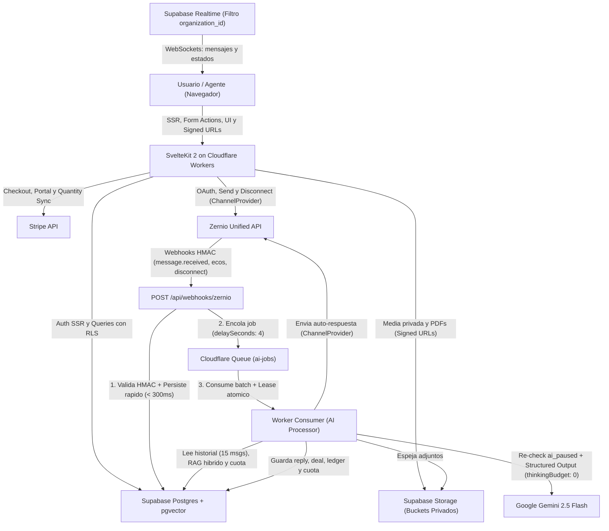
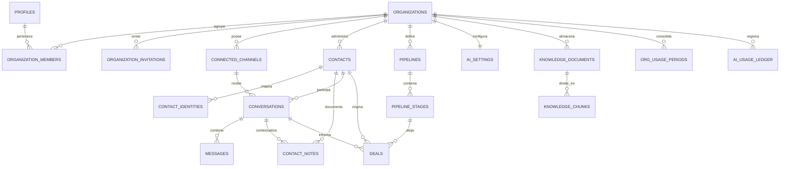
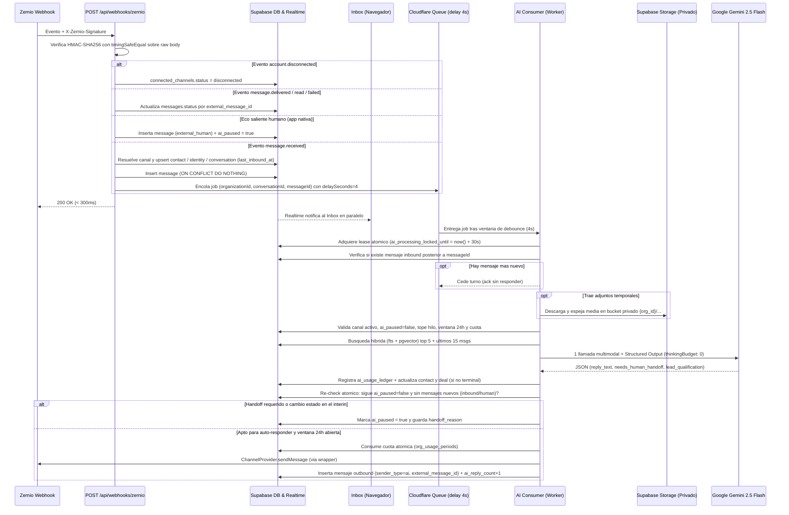

# Design Document — Okeo: SaaS CRM Omnicanal con IA Integrada (v1.1)

> **Propósito:** Definir la arquitectura técnica definitiva, el modelo de datos, el modelo de negocio, los flujos críticos, las salvaguardas de seguridad y el inventario de pantallas para construir **Okeo**, un SaaS CRM omnicanal *zero-friction* ("conecta tus redes y ten tu CRM + IA listo en menos de 2 minutos") optimizado para desarrollo asistido por agentes sobre **SvelteKit 2 (Svelte 5 Runes) + Cloudflare Workers + Supabase + Zernio + Google Gemini + Stripe**.

---

## 1. Visión del Producto, Modelo de Negocio y Alcance (v1 vs v2+)

### Propuesta de valor

Un dueño de negocio o agencia crea su cuenta, conecta sus canales sociales mediante OAuth en un par de clics y obtiene de inmediato:

1. **Una bandeja unificada en tiempo real** para atender mensajes directos de Instagram, Facebook Messenger y WhatsApp, con soporte multimedia y control de ventana de mensajería de 24 horas.
2. **Un asistente de IA listo para usar** (provisto y medido por la plataforma, sin pedir API keys al usuario) capaz de redactar borradores en 1 clic, responder automáticamente usando la base de conocimiento del negocio, comprender notas de voz e imágenes entrantes, escalar a un humano cuando sea necesario y **calificar leads moviendo tarjetas en el Pipeline Kanban**.
3. **Soporte multi-workspace nativo con usuarios ilimitados** para marcas con múltiples líneas de negocio o agencias que administran varios clientes sin penalización por asientos.

### Modelo de Negocio (Cerrado para v1)

- **Trial de 14 días (sin plan Free perpetuo con canales conectados):** Incluye **1 canal conectado**, **100 respuestas de IA** y **5 documentos en Base de Conocimiento**. Al finalizar el trial sin suscripción activa, los canales pasan a estado `paused_billing` (y se desconectan si no se reactivan en un período de gracia) para evitar costos fijos por cuentas inactivas.
- **Suscripción modular por canal ($9 USD/canal/mes):**
  - Cada canal conectado contratado (`channel_slots`) cuesta **$9 USD/mes** en Stripe (facturación por cantidad `quantity` con prorrateo automático).
  - Cada canal incluye **1,000 respuestas de IA mensuales** acumuladas en un **pool compartido por workspace** (`channel_slots × 1,000` por período de facturación).
  - **Usuarios ilimitados por workspace:** No hay `seat_limit`; todos los roles (`owner`, `admin`, `agent`, `viewer`) se invitan sin costo adicional.
- **Ruta de expansión v1.5 / v2+ (Uso excedente de IA):**
  - El esquema de datos (`org_usage_periods` + `ai_usage_ledger` + `organizations.stripe_ai_overage_item_id`) queda preparado desde el día 1 para habilitar **cobro por uso excedente de IA** (*metered billing* con Stripe Billing Meters o paquetes *top-up*) una vez superadas las `1,000 × canales` respuestas mensuales incluidas.

### Principios de diseño

- **Least Configuration Headaches:** Sin formularios técnicos, sin tokens manuales de Meta, sin pegado de API keys de OpenAI/Anthropic y con un pipeline Kanban preconfigurado desde el segundo uno.
- **Safety-First AI:** Modo Copiloto por defecto, *debounce* distribuido con *lease* atómico por conversación, re-verificación antes de enviar, tope de respuestas seguidas por hilo y pausa automática inmediata en cuanto interviene un agente humano (tanto dentro de Okeo como desde la app nativa).
- **Aislamiento de proveedores:** Zernio, Google Gemini y Stripe quedan encapsulados detrás de adaptadores de servidor para no acoplar la lógica de negocio ni la base de datos a un tercero.

### Alcance: qué entra en v1 y qué se pospone a v2+

| Área | En alcance (v1 MVP) | Fuera de alcance (v2+) |
| :--- | :--- | :--- |
| **Canales** | DMs de **Instagram**, **Facebook Messenger** y **WhatsApp** vía Zernio; soporte de **ventana de 24h de Meta** (indicador y manejo de expiración); **múltiples adjuntos** y comprensión de **notas de voz e imágenes entrantes** | Comentarios públicos, TikTok/LinkedIn/X/Telegram, reseñas, plantillas aprobadas de Meta (HSM), canal propio directo sin Zernio |
| **Multi-tenancy y Usuarios** | Múltiples workspaces por usuario, **usuarios ilimitados sin cobro por asiento** (`owner`, `admin`, `agent`, `viewer`), invitaciones por enlace/email | SSO empresarial (SAML/OIDC), permisos granulares por campo o por canal |
| **Onboarding** | Wizard de 3 pasos: crear workspace → conectar redes (OAuth) → texto/PDF inicial + modo Copiloto/Automático, con guía de requisitos Meta (IG Profesional + Página FB; WhatsApp Embedded Signup y cobro directo de Meta al WABA) | Importación histórica masiva desde otros CRMs (HubSpot/Pipedrive), migradores complejos |
| **Inbox** | 3 columnas en tiempo real bajo `/[orgSlug]/inbox` (lista con filtros, hilo con media espejada en bucket privado vía Signed URLs, reproductor de audio, panel CRM), indicador de ventana 24h, asignación, estado y toggle de IA por chat | Notas de voz grabadas en navegador, plantillas aprobadas de Meta, llamadas |
| **Pipeline & CRM** | 1 tablero Kanban prearmado editable (`/[orgSlug]/pipeline`) con orden estable (*fractional indexing*), tarjetas con score y resumen IA, directorio de contactos (`/[orgSlug]/contacts`) con identidades unificadas y `contact_notes` | Múltiples pipelines simultáneos por workspace, constructor avanzado de campos custom, reportes BI |
| **Asistente IA** | Base de conocimiento (FAQs, TXT/PDF extraído vía Gemini multimodal, URLs con protección anti-SSRF), búsqueda híbrida (`fts` + `pgvector` HNSW con `iterative_scan`), comprensión multimodal de audio/imagen entrante, borradores 1-clic, auto-respuesta con pase a humano, calificación y movimiento en Kanban, simulador con rate-limit | Constructor visual *no-code* drag-and-drop con nodos, flujos programados/cron complejos, campañas de Broadcast masivas |
| **SaaS & Billing** | Trial 14 días (1 canal, 100 respuestas IA); suscripción modular **$9 USD/canal/mes** con **1,000 respuestas IA/canal/mes** (pool compartido) y **usuarios ilimitados**; `org_usage_periods` + `ai_usage_ledger`; Stripe Checkout y Customer Portal | Cobro automático por uso excedente de respuestas IA (*Stripe Billing Meters* / paquetes *top-up*), programa de afiliados/marca blanca |
| **Plataforma** | Web app responsive (escritorio + móvil usable en Inbox) | App móvil nativa (iOS/Android), API pública v1 y servidor MCP para clientes |

---

## 2. Arquitectura del Sistema, Stack Cerrado y Economía Unitaria

### Stack tecnológico definitivo

| Capa | Tecnología | Rol y justificación |
| :--- | :--- | :--- |
| **Frontend + BFF** | **SvelteKit 2 + Svelte 5 (Runes)** + Tailwind CSS v4 + `shadcn-svelte` | Menor *boilerplate* que Next.js App Router, *form actions* directas, tipado estricto y compilación ligera ideal para desarrollo asistido por agentes. **Prohibido** usar sintaxis legacy de Svelte 4 (`export let`, `$:`). |
| **Hosting Serverless y Colas** | **Cloudflare Workers** (`@sveltejs/adapter-cloudflare` con Workers Static Assets + `nodejs_compat`) + **Cloudflare Queues** | Se elige **Cloudflare Workers** (no legacy Cloudflare Pages, que no puede consumir colas en el mismo proyecto) porque permite servir SvelteKit y consumir **Cloudflare Queues** nativas con `delaySeconds` para el *debounce* de 3–5s y reintentos sin infraestructura externa. Validar compatibilidad de `@zernio/node` y `stripe` con `nodejs_compat` en el Hito 1. |
| **Datos, Auth, Storage y Realtime** | **Supabase** (PostgreSQL + Auth + RLS + Realtime + Storage privado + `pgvector`) | Resuelve aislamiento multi-tenant en DB, push en tiempo real al Inbox, almacenamiento privado de media/PDFs con Signed URLs y RAG vectorial híbrido en un solo servicio. |
| **Capa de Canales** | **Zernio** (`@zernio/node`) detrás de `ChannelProvider` | Unifica OAuth y webhooks de Instagram, Messenger y WhatsApp en una sola integración; perfiles ilimitados gratuitos (`1 profileId = 1 workspace`). |
| **Proveedor de IA (único)** | **Google Gemini** (`@google/genai`: `gemini-2.5-flash` + embeddings de 768 dims) | Mejor margen unitario, *Structured Outputs* nativos, extracción directa de PDFs (sin dependencias pesadas incompatibles con CF Workers) y **multimodalidad nativa** para procesar notas de voz e imágenes entrantes en WhatsApp/IG. **Obligatorio** fijar `thinkingBudget: 0` en respuestas de chat para proteger el margen. |
| **Facturación SaaS** | **Stripe** | Suscripción por cantidad (`quantity` = canales a $9 USD/mes), Checkout, Customer Portal, webhooks idempotentes y estructura lista para *Billing Meters*. |

### Diagrama de arquitectura



### Economía unitaria ($9 USD/canal/mes + 1,000 respuestas IA + usuarios ilimitados)

#### 1. Estructura real de costos variables

- **Zernio (por tramos globales de cuentas conectadas en la plataforma):**
  - Cuentas 1–2: **$0.00/mes**
  - Cuentas 3–10: **$6.00/cuenta/mes**
  - Cuentas 11–100: **$3.00/cuenta/mes**
  - Cuentas 101–2,000: **$1.00/cuenta/mes**
  - Mensajes salientes: **10,000/mes incluidos gratis**, luego **$0.10 por cada 1,000 adicionales** ($1 por cada 10,000).
- **Google Gemini (`gemini-2.5-flash` con `thinkingBudget: 0`):**
  - Input texto/imagen: **$0.30 / 1M tokens** (Audio: **$1.00 / 1M tokens**).
  - Output: **$2.50 / 1M tokens** (los *thinking tokens* se cobran como output; por eso `thinkingBudget: 0` es obligatorio).
  - Costo por respuesta promedio (~3,000 tokens input entre sistema + RAG + 15 mensajes de historial, y ~300 tokens output JSON): **~$0.00165/respuesta** → **~$1.65 por 1,000 respuestas** (hasta ~$2.20 con notas de voz).
- **Stripe:** `2.9% + $0.30` por cobro (~$0.56 en factura de 1 canal; ~$0.36/canal en factura de 3 canales).

#### 2. Márgenes brutos por escala (sobre ingreso de $9.00/canal/mes)

| Tramo global de canales | Zernio / canal | IA (1,000 resp.) | Stripe (prom. 1–3 ch) | Costo total est. | Margen bruto / canal |
| :--- | :--- | :--- | :--- | :--- | :--- |
| **3–10 canales** *(arranque)* | $6.00 | $1.65 | $0.36 – $0.56 | $8.01 – $8.21 | **~$0.79 – $0.99 (~9% – 11%)** |
| **11–100 canales** *(tracción)* | $3.00 | $1.65 | $0.36 – $0.56 | $5.01 – $5.21 | **~$3.79 – $3.99 (~42% – 44%)** |
| **101–2,000 canales** *(escala)* | $1.00 | $1.65 | $0.36 – $0.56 | $3.01 – $3.21 | **~$5.79 – $5.99 (~64% – 67%)** |

> [!NOTE]
> En uso real, la mayoría de clientes no consume el 100% de las 1,000 respuestas incluidas por canal, por lo que el margen efectivo en 11–100 canales suele rondar el **50%–55%**. Cuando se active el cobro por uso excedente de IA (ej. $5–$7 USD por cada 1,000 respuestas adicionales), el margen incremental de esa capa supera el **70%–75%**.

#### 3. Reglas obligatorias de protección de margen

1. **Sin plan Free perpetuo con canal conectado:** Usar **Trial de 14 días** (1 canal, 100 respuestas IA). Si no suscribe, se pausa el canal (`paused_billing`) y se desconecta en Zernio tras el período de gracia para eliminar cuentas zombi de $1–$6/mes.
2. **`thinkingBudget: 0` obligatorio** en llamadas conversacionales y de calificación con `gemini-2.5-flash`.
3. **Contexto acotado:** Máximo los últimos **15 mensajes** de la conversación y máximo **5 chunks** de `knowledge_chunks` por turno.
4. **Control de abuso en acciones no facturadas directamente:** Limitar documentos de KB por cantidad de canales (`kb_document_limit`, ej. 15 docs por canal) y aplicar *rate-limit* en `POST /api/ai/simulate` y `POST /api/ai/draft` (registrando todo en `ai_usage_ledger` y `org_usage_periods`).
5. **Limpieza al eliminar o cancelar workspace:** Invocar `ChannelProvider.disconnectAccount` al desconectar o eliminar una organización.

### Patrón Adapter (`ChannelProvider`)

Ninguna ruta de SvelteKit, worker ni servicio de dominio puede importar `@zernio/node` directamente. Toda comunicación pasa por `src/lib/server/channels/provider.ts`:

- `createProfile(orgName: string): Promise<{ profileId: string }>`
- `getConnectUrl(params: { profileId: string; platform: Platform; redirectUri: string; state: string }): Promise<{ authUrl: string }>`
- `listAccounts(profileId: string): Promise<ExternalChannelAccount[]>`
- `disconnectAccount(externalAccountId: string): Promise<void>`
- `sendMessage(params: SendMessageInput): Promise<{ externalMessageId: string; sentAt: string }>`
- `verifyAndParseWebhook(request: Request, rawBody: string, secret: string): Promise<NormalizedWebhookEvent>`

---

## 3. Modelo de Datos (Supabase / PostgreSQL) y Seguridad RLS (19 tablas)

### Diagrama Entidad-Relación (Núcleo v1.1)



*(Nota: `stripe_webhook_events` opera como tabla técnica independiente de idempotencia solo accesible vía `service_role`.)*

### Especificación de tablas (19 tablas)

#### A. Usuarios, Multi-tenancy y Facturación SaaS

1. **`profiles`** *(sincronizada con `auth.users` mediante trigger `AFTER INSERT/UPDATE`)*
   - `id` (`uuid PK`, FK `auth.users(id) ON DELETE CASCADE`), `full_name` (`text`), `avatar_url` (`text`), `email` (`text`), `created_at`, `updated_at`.
   - *Motivo:* Desde el cliente con RLS no se debe consultar `auth.users`; esta tabla permite mostrar nombres/avatares de agentes asignados en Inbox y miembros en `/[orgSlug]/settings/team`.

2. **`organizations`**
   - `id` (`uuid PK`), `name` (`text`), `slug` (`text unique`), `industry` (`text`), `language` (`text default 'es'`), `zernio_profile_id` (`text unique`).
   - Billing y cuotas: `subscription_status` (`'trialing' | 'active' | 'past_due' | 'canceled' | 'expired'`), `billing_mode` (`'trial' | 'per_channel'`), `stripe_customer_id` (`text`), `stripe_subscription_id` (`text`), `stripe_channel_item_id` (`text`), `stripe_ai_overage_item_id` (`text null`, reservado v1.5+), `channel_slots` (`int not null default 1`), `included_ai_replies_per_channel` (`int not null default 1000`), `ai_overage_enabled` (`boolean not null default false`), `kb_document_limit` (`int not null default 5`), `trial_ends_at` (`timestamptz`), `current_period_start` (`timestamptz`), `current_period_end` (`timestamptz`), `created_at`.
   - **Nota:** No existe `seat_limit` porque los usuarios son ilimitados.

3. **`organization_members`**
   - `organization_id` (`uuid FK`), `user_id` (`uuid FK profiles`), `role` (`'owner' | 'admin' | 'agent' | 'viewer'`), `created_at`.
   - **PK compuesta:** `(organization_id, user_id)`.
   - **Índice secundario obligatorio:** `(user_id, organization_id)` para acelerar las búsquedas de membresía en RLS.

4. **`organization_invitations`**
   - `id` (`uuid PK`), `organization_id` (`uuid FK`), `email` (`text`), `role` (`'admin' | 'agent' | 'viewer'`), `token_hash` (`text unique`, SHA-256 del token; nunca texto plano), `invited_by` (`uuid FK profiles`), `expires_at` (`timestamptz`), `accepted_at` (`timestamptz null`), `created_at`.

5. **`stripe_webhook_events`**
   - `event_id` (`text PK`), `event_type` (`text`), `processed_at` (`timestamptz default now()`).
   - Sin políticas para `authenticated`/`anon` (solo acceso vía `service_role`) para garantizar idempotencia ante reintentos de Stripe.

#### B. Canales y Contactos Omnicanal

6. **`connected_channels`**
   - `id` (`uuid PK`), `organization_id` (`uuid FK`), `provider` (`'zernio'`), `platform` (`'instagram' | 'facebook' | 'whatsapp'`), `external_account_id` (`text`), `display_name` (`text`), `handle_or_phone` (`text`), `status` (`'active' | 'disconnected' | 'paused_billing' | 'error'`), `metadata` (`jsonb default '{}'`), `created_at`, `updated_at`.
   - **Restricciones:** `UNIQUE (provider, external_account_id)` y `UNIQUE (organization_id, id)` para FKs compuestas.

7. **`contacts`**
   - `id` (`uuid PK`), `organization_id` (`uuid FK`), `name` (`text`), `avatar_url` (`text`), `email` (`text`), `phone` (`text null`), `tags` (`text[] default '{}'`), `lead_score` (`smallint default 0`), `lead_summary` (`text`), `created_at`, `updated_at`.
   - **Restricción:** `UNIQUE (organization_id, id)`.

8. **`contact_identities`**
   - `id` (`uuid PK`), `organization_id` (`uuid FK`), `contact_id` (`uuid`), `platform` (`'instagram' | 'facebook' | 'whatsapp'`), `external_user_id` (`text`), `username_or_phone` (`text`), `created_at`.
   - **Restricciones:** FK compuesta `(organization_id, contact_id)` → `contacts(organization_id, id)` y `UNIQUE (organization_id, platform, external_user_id)`.

9. **`contact_notes`**
   - `id` (`bigint generated always as identity PK`), `organization_id` (`uuid FK`), `contact_id` (`uuid`), `conversation_id` (`uuid null`), `author_user_id` (`uuid FK profiles`), `body` (`text not null`), `created_at`, `updated_at`.
   - **Restricción:** FK compuesta `(organization_id, contact_id)` → `contacts(organization_id, id)`.

#### C. Inbox y Mensajería

10. **`conversations`**
    - `id` (`uuid PK`), `organization_id` (`uuid FK`), `channel_id` (`uuid`), `contact_id` (`uuid`), `external_thread_id` (`text`), `platform` (`'instagram' | 'facebook' | 'whatsapp'`), `status` (`'open' | 'pending' | 'closed'`), `assigned_to` (`uuid FK profiles null`), `ai_paused` (`boolean not null default false`), `ai_handoff_reason` (`text null`), `ai_reply_count` (`int not null default 0`), `ai_processing_locked_until` (`timestamptz null`), `last_processed_inbound_message_id` (`bigint null`), `last_inbound_at` (`timestamptz null`, **base de la ventana de 24h de Meta**), `last_message_preview` (`text`), `last_message_at` (`timestamptz`), `unread_count` (`int not null default 0`), `created_at`, `updated_at`.
    - **Restricciones:** `UNIQUE (channel_id, external_thread_id)`, `UNIQUE (organization_id, id)`, y FKs compuestas `(organization_id, channel_id)` y `(organization_id, contact_id)`.
    - **Reglas de contadores:** `unread_count` se resetea a `0` al abrir el hilo o al responder manualmente; `ai_reply_count` se resetea a `0` cuando responde un humano o cuando el usuario reactiva el toggle de IA.

11. **`messages`**
    - `id` (`bigint generated always as identity PK`), `organization_id` (`uuid FK`), `conversation_id` (`uuid`), `channel_id` (`uuid`), `external_message_id` (`text null`), `direction` (`'inbound' | 'outbound'`), `sender_type` (`'contact' | 'agent' | 'ai' | 'external_human'`), `sender_user_id` (`uuid FK profiles null`), `body` (`text`), `attachments` (`jsonb not null default '[]'`, arreglo de `{ storage_path, mime_type, file_name, size_bytes, kind }`), `status` (`'queued' | 'sent' | 'delivered' | 'read' | 'failed'`), `error_code` (`text null`), `error_detail` (`text null`), `created_at`.
    - **Restricciones:** FK compuesta `(organization_id, conversation_id)` → `conversations(organization_id, id)` y **índice único parcial** `CREATE UNIQUE INDEX messages_channel_external_id_uidx ON public.messages (channel_id, external_message_id) WHERE external_message_id IS NOT NULL;` (permite múltiples mensajes salientes en estado `queued`/`failed` antes de recibir ID externo).

#### D. Pipeline Kanban

12. **`pipelines`**
    - `id` (`uuid PK`), `organization_id` (`uuid FK`), `name` (`text`), `is_default` (`boolean not null default true`), `created_at`.
    - **Restricción:** `UNIQUE (organization_id, id)`.

13. **`pipeline_stages`**
    - `id` (`uuid PK`), `organization_id` (`uuid FK`), `pipeline_id` (`uuid`), `name` (`text`), `slug` (`text`), `color` (`text`), `position` (`double precision not null` para *fractional indexing* sin reescribir toda la columna en drag-and-drop), `is_terminal` (`boolean not null default false`), `ai_qualification_hint` (`text`), `created_at`.
    - **Restricciones:** `UNIQUE (pipeline_id, slug)`, `UNIQUE (organization_id, id)`, FK compuesta `(organization_id, pipeline_id)`.

14. **`deals`**
    - `id` (`uuid PK`), `organization_id` (`uuid FK`), `pipeline_id` (`uuid`), `stage_id` (`uuid`), `contact_id` (`uuid`), `conversation_id` (`uuid null`), `title` (`text`), `value_cents` (`bigint not null default 0`), `currency` (`text not null default 'USD'`), `position` (`double precision not null`), `last_moved_by` (`'human' | 'ai'`), `ai_last_reason` (`text`), `qualification_data` (`jsonb default '{}'`), `created_at`, `updated_at`.
    - **Regla de cardinalidad:** Un contacto puede tener múltiples deals históricos, pero la IA opera únicamente sobre el deal abierto (`is_terminal = false`) más reciente del pipeline default; si el contacto solo tiene deals en etapas terminales (`Ganado` / `Perdido`) y vuelve a escribir, se crea un nuevo deal en la etapa inicial sin sobreescribir los anteriores.
    - **Restricciones:** FKs compuestas `(organization_id, pipeline_id)`, `(organization_id, stage_id)`, `(organization_id, contact_id)`.

#### E. IA Provista, Base de Conocimiento y Control de Consumo

15. **`ai_settings`**
    - `organization_id` (`uuid PK FK`), `enabled` (`boolean not null default true`), `auto_reply_enabled` (`boolean not null default false`), `auto_qualify_enabled` (`boolean not null default true`), `handle_inbound_audio` (`'transcribe_and_reply' | 'handoff_human'`, default `'transcribe_and_reply'`), `business_context` (`text`), `tone` (`'friendly' | 'professional' | 'direct'`), `handoff_rules` (`text`), `max_ai_replies_per_thread` (`int not null default 5`), `updated_at`.

16. **`knowledge_documents`**
    - `id` (`uuid PK`), `organization_id` (`uuid FK`), `title` (`text`), `source_type` (`'faq' | 'text' | 'file' | 'url'`), `source_url` (`text null`), `storage_path` (`text null`), `embedding_model` (`text not null default 'gemini-embedding-001'`), `status` (`'processing' | 'ready' | 'error'`), `error_detail` (`text null`), `created_at`.
    - **Restricción:** `UNIQUE (organization_id, id)`.

17. **`knowledge_chunks`**
    - `id` (`bigint generated always as identity PK`), `organization_id` (`uuid FK`), `document_id` (`uuid`), `content` (`text not null`), `fts` (`tsvector generated always as (to_tsvector('simple', coalesce(content, ''))) stored`), `embedding` (`vector(768)`).
    - **Índices:** GIN sobre `fts` y HNSW (`vector_cosine_ops`) sobre `embedding`. La función RPC de búsqueda híbrida ejecutará `SET LOCAL hnsw.iterative_scan = relaxed_order;` (`pgvector >= 0.8`) para no perder *recall* al filtrar por `organization_id`.

18. **`org_usage_periods`** *(fuente de verdad rápida y atómica para cuotas y facturación)*
    - `id` (`bigint generated always as identity PK`), `organization_id` (`uuid FK`), `period_start` (`timestamptz not null`), `period_end` (`timestamptz not null`), `included_ai_replies` (`int not null`, snapshot de `channel_slots × 1000` o `100` en trial), `used_ai_replies` (`int not null default 0`), `overage_ai_replies` (`int not null default 0`), `draft_count` (`int not null default 0`), `test_chat_count` (`int not null default 0`), `created_at`, `updated_at`.
    - **Restricción:** `UNIQUE (organization_id, period_start)`.
    - **Consumo atómico:** Función SQL `private.consume_ai_reply(p_org_id uuid)` ejecuta `UPDATE ... SET used_ai_replies = used_ai_replies + 1 WHERE ... RETURNING ...` con validación de tope (o incremento de `overage_ai_replies` si `ai_overage_enabled = true`) para evitar carreras bajo concurrencia.

19. **`ai_usage_ledger`** *(bitácora auditable de eventos de consumo y reporte futuro a Stripe)*
    - `id` (`bigint generated always as identity PK`), `organization_id` (`uuid FK`), `usage_period_id` (`bigint FK org_usage_periods null`), `conversation_id` (`uuid null`), `action` (`'auto_reply' | 'draft' | 'qualify_only' | 'embed' | 'test_chat'`), `billable_units` (`int not null default 0`), `model` (`text`), `input_tokens` (`int`), `output_tokens` (`int`), `estimated_cost_micros` (`bigint`), `stripe_meter_reported_at` (`timestamptz null`), `created_at`.

### Reglas de seguridad y rendimiento en Supabase

1. **Esquema `private` y permisos de ejecución correctos:**
   - Crear esquema `private` (no incluido en *Exposed Schemas* de PostgREST).
   - Definir dos helpers `STABLE SECURITY DEFINER SET search_path = ''`:
     - `private.user_org_ids(min_role text DEFAULT 'viewer') RETURNS SETOF uuid`: devuelve los `organization_id` del usuario `(select auth.uid())` que cumplan la jerarquía de rol (`viewer < agent < admin < owner`).
     - `private.is_org_member(target_org_id uuid, min_role text DEFAULT 'viewer') RETURNS boolean`: auxiliar puntual para verificaciones explícitas o políticas `INSERT`/`UPDATE`.
   - **Permisos obligatorios:**
     ```sql
     REVOKE ALL ON SCHEMA private FROM PUBLIC, anon;
     GRANT USAGE ON SCHEMA private TO authenticated;
     REVOKE ALL ON FUNCTION private.user_org_ids(text) FROM PUBLIC, anon;
     GRANT EXECUTE ON FUNCTION private.user_org_ids(text) TO authenticated;
     REVOKE ALL ON FUNCTION private.is_org_member(uuid, text) FROM PUBLIC, anon;
     GRANT EXECUTE ON FUNCTION private.is_org_member(uuid, text) TO authenticated;
     ```
2. **Políticas RLS con verdadero `InitPlan`:**
   - Habilitar RLS en **todas** las tablas de `public`.
   - Especificar `TO authenticated` (nunca `auth.role()`).
   - **Evitar subconsultas correlacionadas fila-a-fila:** usar `USING (organization_id IN (SELECT private.user_org_ids('viewer')))` para que PostgreSQL materialice un `InitPlan` único por consulta y aproveche el índice sobre `organization_id`.
   - Incluir tanto `USING` como `WITH CHECK` en políticas `UPDATE`, y `WITH CHECK` en `INSERT`, impidiendo mover filas entre organizaciones.
   - Indexar `organization_id`, `(user_id, organization_id)` en `organization_members`, y todas las llaves foráneas usadas en filtros/joins.
3. **Supabase Storage privado:**
   - Buckets `dm-media` y `knowledge-files` configurados como **privados** (`public = false`).
   - Convención obligatoria de rutas: `{organization_id}/{resource_id}/{filename}`.
   - Política RLS en `storage.objects`: acceso solo si `(storage.foldername(name))[1]::uuid IN (SELECT private.user_org_ids('viewer'))`.
   - El frontend solicita vistas previas/descargas mediante `GET /api/media/signed-url` (que valida pertenencia y emite una **Signed URL de corta duración**, ej. 5–15 min).
4. **Realtime acotado por tenant:**
   - Todas las suscripciones `postgres_changes` deben incluir filtro explícito `filter: 'organization_id=eq.' + orgId`.
5. **Claves y sesión SSR:**
   - `SUPABASE_SERVICE_ROLE_KEY`, claves de Zernio, Gemini y Stripe existen **solo en entorno servidor**; nunca en `PUBLIC_*`.
   - Jamás usar `user_metadata` para autorización ni confiar en `getSession()` sin validar JWT vía `safeGetSession` (`getUser()` / `getClaims()`).

---

## 4. Flujos Críticos del Sistema

### Flujo A: Onboarding "Conecta tus redes y listo" (OAuth seguro)

1. **Paso 1 (Workspace):** Usuario ingresa nombre, rubro e idioma. El servidor crea en Zernio un perfil (`createProfile`) y en Supabase la fila en `organizations` (`subscription_status = 'trialing'`, `channel_slots = 1`, `trial_ends_at = now() + 14 days`), `organization_members` (`owner`), `ai_settings`, `pipelines` + `pipeline_stages` por defecto, y el primer `org_usage_periods` (100 respuestas IA).
2. **Paso 2 (OAuth Meta/WhatsApp):**
   - El usuario elige IG, Messenger o WhatsApp (con aviso breve de requisitos: cuenta Profesional IG conectada a Página FB; WhatsApp requiere Embedded Signup de Meta y facturación de plantillas directamente en su WABA).
   - `POST /api/channels/connect` valida rol `admin+`, que la org no esté `past_due`/`expired`, y que `canales activos < channel_slots`.
   - Genera un `state` firmado con **HMAC-SHA256** que incluye `{ organizationId, userId, nonce, exp }` (expira en 10 min) y solicita `authUrl` vía `ChannelProvider.getConnectUrl`.
   - En `GET /api/channels/connect/callback`, el servidor verifica firma y expiración del `state`, confirma membresía actual del `userId`, llama `listAccounts(profileId)` para verificar que el `accountId` pertenece al perfil de la org y **verifica que no exista en otro workspace** (si `UNIQUE (provider, external_account_id)` pertenece a otra org, rechaza con error claro sin reasignar la cuenta).

### Flujo B: Webhook entrante + Debounce con Lease + Multimodal + Kanban



### Flujo C: Billing por Canal ($9/mes) y Escalado a Uso de IA

1. **Checkout / Gestión de canales:** Desde `/[orgSlug]/settings/billing` o al intentar conectar un canal por encima de `channel_slots`, el `owner`/`admin` inicia Stripe Checkout (`POST /api/billing/checkout`) con el `price_id` de **$9 USD/canal/mes** y `quantity` deseada, o ajusta la cantidad desde `POST /api/billing/channels-quantity` (con prorrateo Stripe) o Stripe Customer Portal.
2. **Sincronización idempotente (`POST /api/webhooks/stripe`):**
   - Verifica `Stripe-Signature`.
   - Inserta `event.id` en `stripe_webhook_events` (`ON CONFLICT DO NOTHING`; si ya existe, responde `200 OK` de inmediato).
   - Al recibir `checkout.session.completed`, `customer.subscription.updated`, `customer.subscription.deleted` o `invoice.payment_failed`: actualiza `subscription_status`, `channel_slots`, `kb_document_limit`, `current_period_start`, `current_period_end` y hace `upsert` de `org_usage_periods` con `included_ai_replies = channel_slots × 1000`.
3. **Downgrade / Impago / Fin de Trial:** Si `channel_slots` cae por debajo de los canales activos, el exceso más antiguo (o los seleccionados por el usuario) pasa a `paused_billing` y se pausa la auto-respuesta; si entra a `canceled`/`expired`, tras el período de gracia se ejecuta `ChannelProvider.disconnectAccount` en Zernio para no seguir pagando por cuentas inactivas.
4. **Preparación v1.5+ (Uso excedente de IA):** Cada respuesta IA adicional fuera de `included_ai_replies` incrementará `overage_ai_replies` y podrá reportarse de forma asíncrona a Stripe Billing Meters usando `ai_usage_ledger.stripe_meter_reported_at` como marca de idempotencia.

### Contrato JSON de la IA (Structured Output) y Guardrails

En una sola llamada al LLM (`gemini-2.5-flash`, `thinkingBudget: 0`), se exige el siguiente esquema JSON estricto:

```json
{
  "reply_text": "Hola, claro. El plan cuesta $9 USD/mes por canal e incluye 1,000 respuestas de IA y usuarios ilimitados. ¿Qué red quieres conectar primero?",
  "needs_human_handoff": false,
  "handoff_reason": null,
  "lead_qualification": {
    "score": 82,
    "intent": "pricing_inquiry",
    "recommended_stage_slug": "qualified",
    "summary": "Consulta precio por canal; alta intención de compra.",
    "extracted_fields": {
      "email": null,
      "phone": null,
      "estimated_value_cents": 2700
    }
  }
}
```

#### 8 Guardrails obligatorios

1. **Intervención humana (interna y externa):** Si un agente responde desde `/inbox` **o el dueño responde desde la app nativa de IG/FB/WA** (eco saliente), `conversations.ai_paused` pasa a `true` inmediatamente. La IA no vuelve a auto-responder ese hilo hasta que se reactive manualmente (reseteando `ai_reply_count = 0`).
2. **Protección de etapas terminales:** La IA **nunca** modifica un deal colocado en una etapa `is_terminal = true` (`Ganado` o `Perdido`). Si el cliente reescribe después de cerrar un deal previo, se crea un nuevo deal en la etapa inicial.
3. **Debounce + Lease + Re-check atómico:** Además del `delaySeconds: 4` en Cloudflare Queues y la verificación inicial de mensaje más reciente, el consumer toma un *lease* (`ai_processing_locked_until`) y vuelve a verificar `ai_paused = false` y ausencia de mensajes nuevos justo antes de llamar a `sendMessage`.
4. **Ventana de 24 horas de Meta:** Antes de enviar cualquier mensaje automático o manual, el servidor revisa `last_inbound_at >= now() - interval '24 hours'`. Si expiró, no llama a Zernio innecesariamente y muestra aviso claro en `/inbox`.
5. **Espejado de multimedia en Storage privado:** Todos los adjuntos entrantes se descargan y guardan en el bucket privado `dm-media` bajo `{organization_id}/...` para evitar enlaces caducos de Meta y exposición pública.
6. **Tope duro de cuota (o overage habilitado):** Al alcanzar `included_ai_replies` en `org_usage_periods` (cuando `ai_overage_enabled = false`), la auto-respuesta y el borrador IA devuelven estado controlado de cuota agotada sin interrumpir jamás la recepción ni el envío manual de mensajes.
7. **Anti-Prompt Injection y validación de salida:** El mensaje entrante del cliente (y cualquier texto de URL/PDF) se aísla como contenido no confiable en rol `user`; `recommended_stage_slug` se valida en servidor contra los slugs reales no terminales del pipeline del workspace antes de actualizar `deals`.
8. **Anti-SSRF en Base de Conocimiento (`source_type = 'url'`):** Antes de descargar una URL, el servidor resuelve/valida que el host use HTTPS/HTTP público y bloquea rangos privados, loopback y metadata (`127.0.0.0/8`, `10.0.0.0/8`, `172.16.0.0/12`, `192.168.0.0/16`, `169.254.0.0/16`, `::1`, `fc00::/7`), limitando tamaño de respuesta y redirecciones.

---

## 5. Inventario y Especificación de Pantallas (19 vistas y estados)

> **Convención de rutas multi-workspace:** Todas las pantallas autenticadas dentro de un workspace viven bajo **`/[orgSlug]/...`** (nunca en rutas planas `/inbox` ni dependiendo de una cookie global de "org activa") para evitar envíos cruzados cuando una agencia trabaja con varias pestañas abiertas.

### Layout Base de la App

- **Sidebar izquierdo delgado:**
  - Arriba: **Selector de Workspace** (muestra workspace actual + popover para cambiar de marca/cliente o crear uno nuevo).
  - Navegación principal (5 ítems): **Dashboard**, **Inbox** (con badge de no leídos / requieren humano), **Pipeline**, **Contactos**, **Asistente IA**, y abajo **Ajustes** + perfil de usuario.

### Bloque 1 — Acceso y Onboarding (5 pantallas)

1. **Login / Registro (`/login`, `/signup`):** OAuth con Google + Email/Contraseña o Magic Link, diseño limpio sin distracciones.
2. **Aceptar invitación (`/invite/[token]`):** Valida el hash SHA-256 del token, muestra nombre del workspace y rol asignado, y permite unirse en 1 clic tras autenticarse.
3. **Onboarding — Paso 1: Crear workspace (`/onboarding`):** Nombre de la marca, rubro (preconfigura etapas del Kanban y tono sugerido) e idioma.
4. **Onboarding — Paso 2: Conectar redes (`/onboarding`):** 3 tarjetas grandes (**Instagram**, **Facebook Messenger**, **WhatsApp**) con requisitos previos claros, botón *"Conectar"* (OAuth Zernio con `state` HMAC) y estado en vivo (*Conectado* con check verde). Permite avanzar con al menos 1 red conectada.
5. **Onboarding — Paso 3: Entrenar IA y elegir modo (`/onboarding`):** Cuadro simple de texto/FAQ inicial (o subida de PDF) + selección clara entre **Modo Copiloto** (recomendado) o **Modo Piloto Automático**. Botón final *"Ir a mi Inbox"*.

### Bloque 2 — Operación Diaria (7 pantallas)

6. **Dashboard (`/[orgSlug]/dashboard`):** 4 tarjetas KPI (*Chats abiertos*, *Esperando humano*, *Leads calificados por IA*, *Valor del pipeline*) + 2 listas accionables (*Requieren atención humana* y *Últimos leads calificados*).
7. **Inbox Omnicanal (`/[orgSlug]/inbox`):** Pantalla estrella de 3 columnas:
   - *Izquierda:* buscador, filtros (*Todos*, *Sin leer*, *Míos*, *Requieren humano*) + filtro por icono de canal; preview con badge de red y estado de IA.
   - *Centro:* header con asignación de agente, estado (*Abierto/Pendiente/Cerrado*), **indicador de ventana de 24h** y toggle **IA Activa / Pausada**; burbujas diferenciadas (*Cliente vs Agente vs IA vs Externo*), reproductor de notas de voz e imágenes vía Signed URLs; composer con adjuntos y botón destacado **"✨ Sugerir respuesta"** (bloqueado con aviso claro si la ventana de 24h cerró).
   - *Derecha (colapsable):* tarjeta de **Resumen IA + Lead Score**, selector directo de etapa del Pipeline (indicando si la movió la IA y por qué), identidades sociales, etiquetas y notas internas (`contact_notes`).
8. **Pipeline Kanban (`/[orgSlug]/pipeline`) + Drawer de Deal:** Columnas arrastrables (*fractional indexing*) con tarjetas que muestran canal, valor, badge de score (*Frío/Tibio/Caliente*) y motivo de calificación IA; clic abre **Drawer** con historial de movimientos y botón *"Abrir chat en Inbox"*; botón discreto *"Editar etapas"*.
9. **Contactos (`/[orgSlug]/contacts`) + Detalle (`/[orgSlug]/contacts/[id]`):** Tabla buscable filtrable por canal, etiqueta y score; detalle unificado con todas sus `contact_identities` (IG, FB, WA), historial de deals, notas y conversaciones.
10. **Asistente IA — Comportamiento + Chat de prueba (`/[orgSlug]/ai`):** Switches de *Borradores*, *Auto-respuesta* y *Calificación automática*; política de notas de voz (*Transcribir y responder* vs *Pasar a humano*); selector de tono; reglas de pase a humano; tope de respuestas seguidas; y **simulador en vivo a la derecha** (con rate-limit visible).
11. **Asistente IA — Base de Conocimiento (`/[orgSlug]/ai/knowledge`):** Carga de PDFs/TXT (almacenados en bucket privado `knowledge-files`), importación de URLs (con validación anti-SSRF) o pares rápidos de *Pregunta / Respuesta (FAQ)* con estado (`Procesando / Listo / Error`).
12. **Asistente IA — Reglas de calificación del Pipeline (`/[orgSlug]/ai/qualification`):** Lista de las etapas del Kanban donde el usuario describe en lenguaje natural cuándo mover un lead a cada etapa.

### Bloque 3 — Ajustes y SaaS (3 subpantallas)

13. **Ajustes — Canales conectados (`/[orgSlug]/settings/channels`):** Estado en tiempo real de cada cuenta (`active`, `disconnected`, `paused_billing`, `error`), botones *"Conectar otra red"*, *"Reconectar"* y *"Desconectar"*, más contador de cupos contratados (ej. `2 de 3 canales activos`) con CTA para añadir un canal (+$9 USD/mes).
14. **Ajustes — Equipo y Workspaces (`/[orgSlug]/settings/team`):** Gestión de **usuarios ilimitados** y roles (`Owner`, `Admin`, `Agente`, `Viewer`), envío/revocación de invitaciones por enlace/email y acceso a gestión/eliminación del workspace.
15. **Ajustes — Plan, Facturación y Consumo de IA (`/[orgSlug]/settings/billing`):** Resumen del plan modular (**$9 USD/canal/mes**), selector de número de canales (`+$9/mes` por canal), barras visuales de consumo (**Canales activos vs cupos** y **Pool mensual de respuestas IA**, ej. `1,420 / 3,000` en 3 canales; **Usuarios: Ilimitados**) y botón *"Gestionar facturación"* (Stripe Customer Portal).

### Bloque 4 — Estados y Modales Clave (4 componentes transversales)

16. **Selector de Workspace + Modal "Nuevo workspace":** Cambio instantáneo de ruta (`/[orgSlug]/...`) y creación de nuevas marcas desde cualquier pantalla.
17. **Empty states guiados:**
    - Sin canales conectados → CTA directo *"Conectar tu primera red"*.
    - Canal conectado sin mensajes → instrucción de prueba (*"Envía un DM de prueba para verlo llegar aquí en vivo"*).
18. **Banner global de canal desconectado:** Aparece al recibir `account.disconnected` con botón *"Reconectar en 1 clic"*.
19. **Banner / Modal de límite de plan o fin de trial:** Alerta clara al alcanzar los `channel_slots`, el pool mensual de respuestas IA o al expirar el trial de 14 días, con CTA directo a Stripe Checkout/Portal sin interrumpir la lectura o respuesta manual del Inbox.

---

## 6. Estructura del Proyecto, API y Convenciones para Agentes

### Árbol de carpetas propuesto (`okeo/`)

```text
okeo/
├── AGENTS.md                        # Contrato estricto para agentes de programación
├── wrangler.jsonc                   # Configuración Cloudflare Workers + Static Assets + Queues
├── docs/
│   └── design-document.md           # Fuente de verdad técnica y de producto (este doc)
├── supabase/
│   ├── config.toml
│   └── migrations/                  # 001_core_tenancy_billing.sql, 002_channels_inbox.sql, 003_crm_ai_rag.sql, 004_storage_rls.sql
└── src/
    ├── hooks.server.ts              # Cliente Supabase SSR, safeGetSession (getUser/getClaims)
    ├── worker.ts                    # Entrypoint/export de queue consumer en Cloudflare Workers (si aplica con adapter-cloudflare)
    ├── lib/
    │   ├── types/                   # Tipos generados de Supabase + DTOs del dominio
    │   ├── validation/              # Esquemas Zod/Valibot compartidos
    │   ├── server/
    │   │   ├── supabase-admin.ts    # Cliente service_role (solo server: webhooks, workers, callback)
    │   │   ├── storage.ts           # Subida a buckets privados y emisión de Signed URLs
    │   │   ├── channels/
    │   │   │   ├── provider.ts      # Interfaz ChannelProvider (agnóstica de proveedor)
    │   │   │   ├── state.ts         # Firma y verificación HMAC-SHA256 del state OAuth
    │   │   │   └── zernio.ts        # Implementación concreta con @zernio/node
    │   │   ├── ai/
    │   │   │   ├── client.ts        # Wrapper único @google/genai (gemini-2.5-flash, thinkingBudget: 0)
    │   │   │   ├── rag.ts           # Extracción PDF/URL (anti-SSRF), chunking, embeddings e hybrid search
    │   │   │   ├── processor.ts     # Lease atómico, debounce, ventana 24h, guardrails, Kanban y reply
    │   │   │   └── prompts.ts       # Prompts de sistema + schema de Structured Output
    │   │   ├── queue/
    │   │   │   └── producer.ts      # Abstracción para encolar en Cloudflare Queue (delaySeconds)
    │   │   ├── billing/
    │   │   │   ├── plans.ts         # Reglas: Trial 14d + $9/canal/mes + 1,000 resp IA/canal
    │   │   │   └── stripe.ts        # Checkout, Portal, sync de quantity e idempotencia
    │   │   └── crm/                 # Servicios: conversations, contacts, deals, channels, usage
    │   └── components/              # ui/ (shadcn-svelte), inbox/, kanban/, onboarding/, shared/
    └── routes/
        ├── (auth)/                  # login/, signup/, invite/[token]/
        ├── (app)/
        │   ├── onboarding/
        │   └── [orgSlug]/
        │       ├── dashboard/
        │       ├── inbox/
        │       ├── pipeline/
        │       ├── contacts/        # + [id]/
        │       ├── ai/              # +page, knowledge/, qualification/
        │       └── settings/        # channels/, team/, billing/
        └── api/
            ├── webhooks/zernio/     # POST ingesta rápida HMAC + idempotencia + Queue
            ├── webhooks/stripe/     # POST eventos de suscripción idempotentes
            ├── channels/connect/    # POST inicio OAuth y GET callback/
            ├── channels/disconnect/ # POST desconexión en Zernio + DB
            ├── messages/send/       # POST envío manual (chequea ventana 24h y pausa IA)
            ├── media/signed-url/    # GET Signed URL verificando membresía org
            ├── ai/draft/            # POST borrador 1-clic
            ├── ai/simulate/         # POST chat de prueba (con rate-limit)
            └── billing/             # checkout/, portal/, channels-quantity/
```

### Endpoints principales de API

> Toda ruta autenticada bajo `/api/*` exige `organizationId` explícito en el body o query (nunca tomado de una cookie global), valida con Zod/Valibot y verifica membresía/rol en `organization_members`.

| Endpoint | Autenticación | Propósito |
| :--- | :--- | :--- |
| `POST /api/webhooks/zernio` | Firma `X-Zernio-Signature` (`HMAC-SHA256` con `timingSafeEqual`) | Ingesta rápida e idempotente (`message.received`, ecos externos, estados de entrega, `account.disconnected`); encola job en CF Queue con `delaySeconds: 4`. |
| `POST /api/webhooks/stripe` | Firma `Stripe-Signature` + `stripe_webhook_events` | Sincroniza `subscription_status`, `channel_slots`, fechas de ciclo y `org_usage_periods` de forma idempotente. |
| `POST /api/channels/connect` | Sesión + rol `admin+` + `organizationId` | Verifica `channel_slots` disponibles y estado de suscripción, genera `state` HMAC y devuelve `authUrl` de Zernio. |
| `GET /api/channels/connect/callback` | Sesión + `state` HMAC válido | Verifica firma/expiración y pertenencia del `accountId`, evita colisiones entre orgs y registra/reactiva el canal en `connected_channels`. |
| `POST /api/channels/disconnect` | Sesión + rol `admin+` + `organizationId` | Desconecta la cuenta en Zernio vía `ChannelProvider` y marca `status = 'disconnected'`. |
| `POST /api/messages/send` | Sesión + rol `agent+` + `organizationId` | Verifica ventana de 24h de Meta, envía mensaje manual vía `ChannelProvider`, persiste en `messages` y pausa la IA (`ai_paused = true`). |
| `GET /api/media/signed-url` | Sesión + rol `viewer+` + `organizationId` | Verifica que la ruta del archivo pertenezca al prefijo `{organization_id}/` y genera una Signed URL temporal del bucket privado. |
| `POST /api/ai/draft` | Sesión + rol `agent+` + `organizationId` | Genera borrador en 1 clic usando historial reciente + RAG sin enviarlo al cliente y registra en `ai_usage_ledger`. |
| `POST /api/ai/simulate` | Sesión + rol `admin+` + `organizationId` | Ejecuta el chat de prueba en `/ai` contra la KB del workspace (con tope diario/por hora). |
| `POST /api/billing/checkout` | Sesión + rol `admin+` + `organizationId` | Crea sesión de Stripe Checkout modular ($9/canal/mes × `quantity`). |
| `POST /api/billing/channels-quantity` | Sesión + rol `admin+` + `organizationId` | Actualiza `quantity` de canales en la suscripción Stripe activa con prorrateo. |
| `POST /api/billing/portal` | Sesión + rol `admin+` + `organizationId` | Abre el Stripe Customer Portal para tarjetas, facturas y cancelaciones. |

---

## 7. Hoja de Ruta v1 (4 Hitos) y Decisiones Cerradas

### Plan de ejecución por hitos

1. **Hito 1 — Cimientos Multi-Tenant, Auth y Esqueleto UI**
   - Proyecto **SvelteKit 2 + Svelte 5 (Runes)** + Tailwind v4 + `shadcn-svelte` desplegable en **Cloudflare Workers** (`nodejs_compat` validado desde el día 1 con `@zernio/node` y `stripe`).
   - `hooks.server.ts` con `safeGetSession` (`getUser()`/`getClaims()`).
   - Migraciones iniciales: `profiles` (+ trigger `auth.users`), `organizations`, `organization_members`, `organization_invitations`, `pipelines`, `pipeline_stages`, `ai_settings`, esquema `private` con `user_org_ids()`/`is_org_member()`, grants a `authenticated` y políticas RLS con `InitPlan`.
   - Pantallas: Login/Signup, Invitaciones, Selector de Workspace (`/[orgSlug]/...`) y Paso 1 de Onboarding.

2. **Hito 2 — Integración Zernio e Inbox Omnicanal en Tiempo Real**
   - Adaptador `ChannelProvider` (`zernio.ts` + firma `state` HMAC), Paso 2 de Onboarding y `/[orgSlug]/settings/channels`.
   - Buckets privados en Supabase Storage (`dm-media`, `knowledge-files`) con RLS y `GET /api/media/signed-url`.
   - Webhook `POST /api/webhooks/zernio` con verificación `timingSafeEqual`, idempotencia parcial, manejo de ecos salientes (`external_human`) y estados de entrega.
   - Inbox de 3 columnas bajo `/[orgSlug]/inbox` con Supabase Realtime (`filter: organization_id=eq...`), indicador de ventana de 24h, envío manual, Contactos básicos + `contact_notes` y Banner de desconexión.

3. **Hito 3 — IA Provista (RAG + Multimodal + Copiloto + Piloto Automático + Kanban)**
   - Ingesta y chunking de KB (extracción PDF vía Gemini, URLs con protección anti-SSRF, `fts` `'simple'` + `pgvector` HNSW con `iterative_scan`), Paso 3 de Onboarding y pantallas `/[orgSlug]/ai/*` (incluyendo simulador con rate-limit).
   - Consumer en **Cloudflare Queues** (`delaySeconds: 4`), *lease* atómico, re-check pre-envío, soporte multimodal para notas de voz/imágenes entrantes, `gemini-2.5-flash` con `thinkingBudget: 0`, registro en `ai_usage_ledger` + `org_usage_periods`, pase a humano automático y movimiento seguro en `/[orgSlug]/pipeline` (*fractional indexing* y protección `is_terminal`).

4. **Hito 4 — Capa SaaS ($9/canal), Límites y Lanzamiento**
   - Integración Stripe modular (**$9 USD/canal/mes**, `quantity = channel_slots`, usuarios ilimitados, Checkout + Portal + `stripe_webhook_events`) y pantalla `/[orgSlug]/settings/billing`.
   - Enforcement de Trial de 14 días, límites de `channel_slots` y pool de `1,000 × canales` respuestas IA (con limpieza Zernio tras fin de trial/cancelación) + Dashboard ligero (`/[orgSlug]/dashboard`) + pruebas end-to-end de seguridad RLS, race conditions y webhooks.

### Decisiones estratégicas cerradas para v1

1. **Proveedor único de IA:** **Google Gemini (`gemini-2.5-flash` con `thinkingBudget: 0` + embeddings de 768 dims)** por su economía unitaria, *Structured Output* nativo y capacidad multimodal para notas de voz, imágenes y PDFs sin servicios externos.
2. **Hosting Serverless y Colas:** **Cloudflare Workers (Workers Static Assets) + Cloudflare Queues** (`delaySeconds` nativo para el debounce de 4s y reintentos sin servicios extra).
3. **Modelo de negocio inicial:**
   - **Trial de 14 días** (1 canal, 100 respuestas IA, 5 docs KB; sin plan Free perpetuo con canal conectado).
   - **Suscripción modular a $9 USD/canal/mes** con **1,000 respuestas de IA mensuales por canal** (pool compartido por workspace) y **usuarios ilimitados**.
   - **Arquitectura preparada para v1.5+:** Medición exacta en `org_usage_periods` y `ai_usage_ledger` lista para activar *metered billing* por excedente de respuestas IA en Stripe.
